# AI Product Engineering III — Day 4: Agentic Workflows

Tujuh pola workflow yang umum dipakai, dibangun dengan `Pipeline` dari [Anvia](https://www.npmjs.com/package/@anvia/core): chaining, routing, extraction, evaluator-optimizer, parallel fan-out, plan-and-execute, dan agentic decision. Ditambah observability untuk memantau jalannya pipeline.

Setiap file di `src/` adalah contoh kecil yang bisa langsung dijalankan. Di bagian atas tiap file ada komentar berbahasa Indonesia (APA / KENAPA / ALUR / CATATAN) yang menjelaskan isi dan alasannya. Screenshot di bawah diambil dari slide Day 4.

## Kenapa workflow?

Satu prompt besar sulit di-debug dan hasilnya sulit diprediksi. **Workflow** memecah pekerjaan jadi langkah-langkah kecil: kode yang mengatur alurnya, dan LLM hanya mengerjakan satu tugas fokus di tiap langkah. Hasilnya:

- **Lebih andal:** tiap langkah sederhana, jadi jawabannya lebih baik.
- **Mudah di-debug:** kelihatan di langkah mana yang salah.
- **Terkendali:** kode yang memutuskan langkah berikutnya, bukan model.

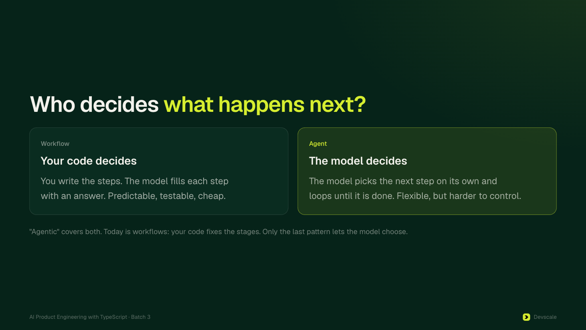

Pola-pola di bawah adalah blok bangunan dasar. Produk nyata biasanya menggabungkan beberapa sekaligus.

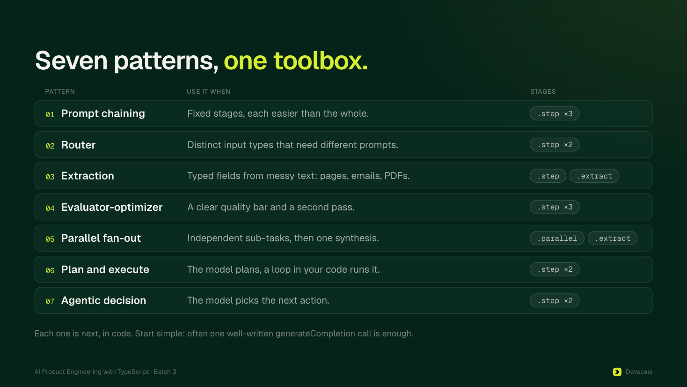

## Konsep inti

- **`Pipeline`** adalah daftar langkah (step). Setiap step menerima output step sebelumnya sebagai `input`.
- **`inputSchema`** (zod) memvalidasi input sebelum apa pun dijalankan.
- **Structured output:** kirim schema zod ke `askAiJson`, maka model membalas JSON bertipe, bukan teks bebas. Inilah yang membuat kode biasa (`if`, `switch`, `Promise.all`) bisa mengambil keputusan dari output model.
- **Jenis stage yang dipakai:** `.step` (jalankan kode apa saja), `.parallel` (jalankan beberapa cabang bersamaan), `.extract` (ubah teks jadi schema).

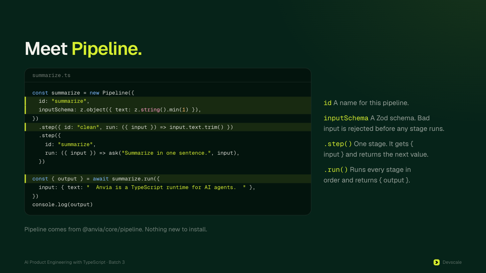

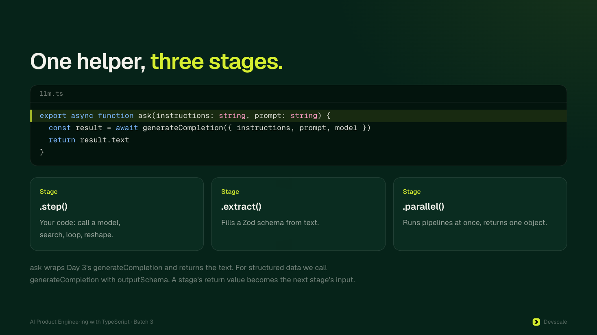

## Setup

```bash
bun install
```

Buat file `.env`:

```
OPENAI_BASE_URL=...
OPENAI_API_KEY=...
```

## Menjalankan

```bash
bun src/<file>.ts
bun run typecheck
```

## Pola

### 1. Prompt chaining — `01-prompt-chaining.ts`, `00-basic-pipeline.ts`

Output satu langkah menjadi input langkah berikutnya.

- **Kenapa:** tugas besar ("riset perusahaan") dipecah jadi langkah mudah yang bisa dicek satu per satu.
- **Pakai saat:** tugas punya tahapan berurutan yang jelas.
- **Alur:** `generate-query → web-search → summarize`

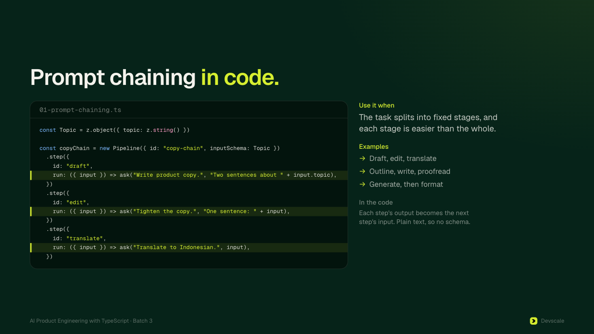

### 2. Routing — `02-router.ts`

Model mengklasifikasikan input, lalu kode mengarahkannya ke jalur yang tepat.

- **Kenapa:** setiap jenis permintaan butuh penanganan berbeda. Prompt khusus lebih baik daripada satu prompt umum.
- **Pakai saat:** input terbagi ke kategori yang jelas (teknis, tagihan, umum).
- **Alur:** `klasifikasi intent → pilih handler`

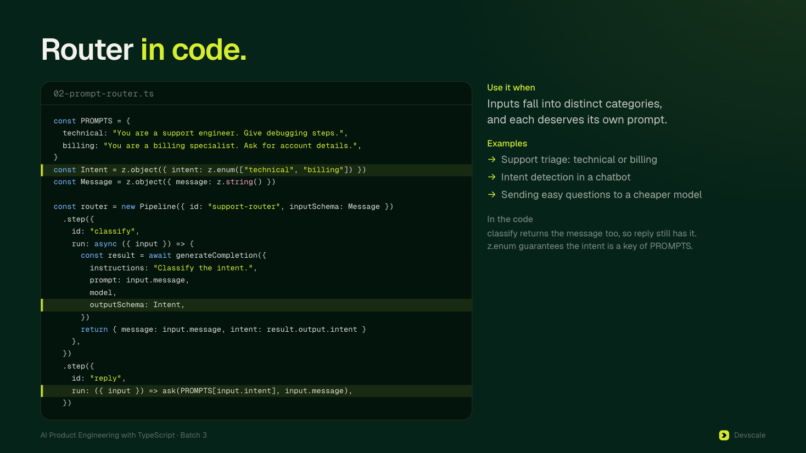

### 3. Extraction — `04-extract-company.ts`

Mengubah teks berantakan (hasil pencarian) jadi object bertipe dengan `.extract`.

- **Kenapa:** data terstruktur bisa disimpan, divalidasi, dan ditampilkan. Teks bebas tidak bisa.
- **Tips:** `.describe()` pada field schema menjadi petunjuk untuk model. Instruksi "return NONE jika tidak ada" mencegah model mengarang data.
- **Alur:** `search → extract`

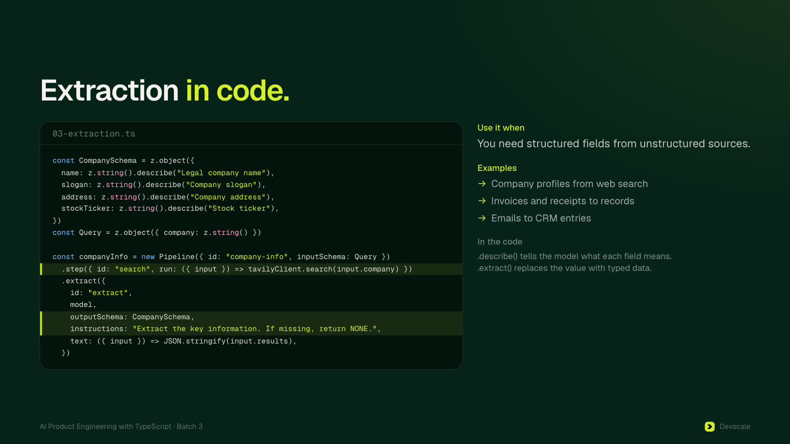

### 4. Evaluator-optimizer — `05-evaluator-optimizer.ts`

Satu panggilan menulis, satu menilai, dan satu merevisi hanya jika perlu.

- **Kenapa:** draf pertama sering belum memenuhi standar. Satu langkah review yang murah menaikkan kualitas tanpa campur tangan manusia.
- **Pakai saat:** ada kriteria kualitas yang jelas.
- **Alur:** `draft → evaluate → revise`

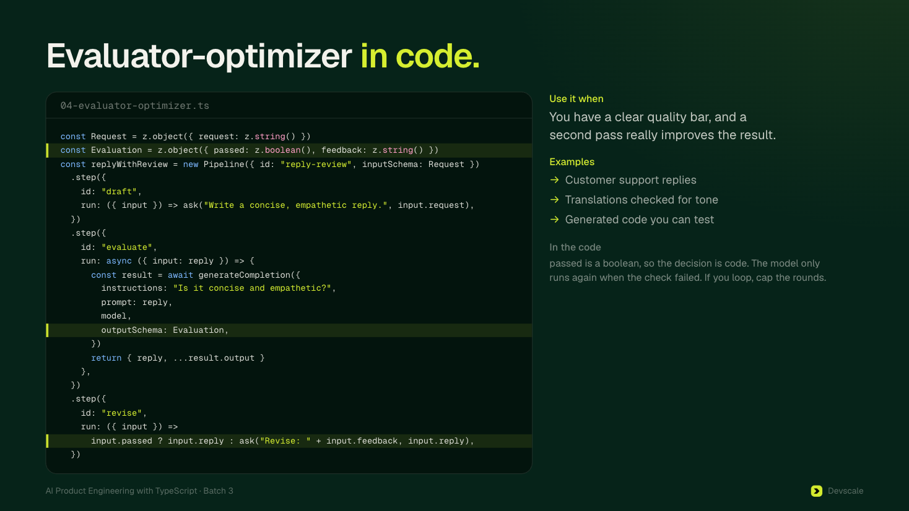

### 5. Parallel fan-out — `03-parallel-fanout.ts`

Cabang-cabang yang independen berjalan bersamaan, lalu hasilnya digabung.

- **Kenapa:** lebih cepat daripada berurutan, dan tiap cabang fokus pada satu sudut pandang.
- **Pakai saat:** sub-tugas tidak saling bergantung.
- **Alur:** `product | engineering | business → summarize`

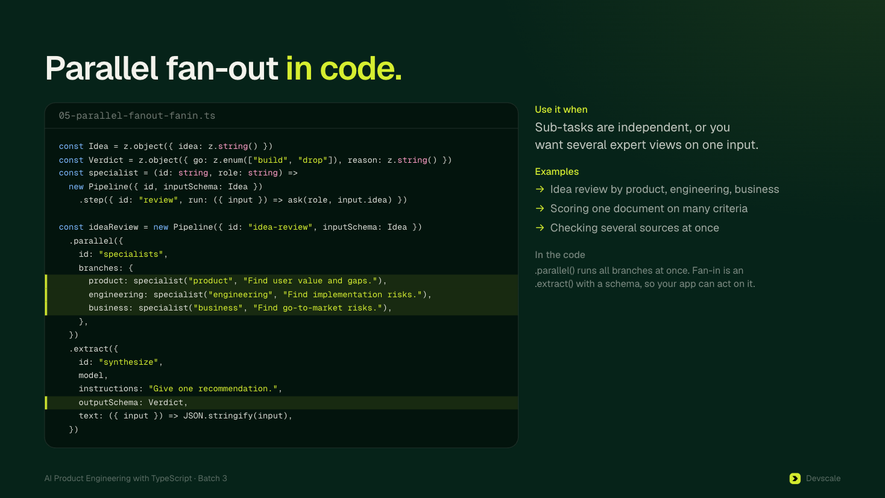

### 6. Plan-and-execute — `06-plan-and-execute.ts`

Model membuat rencana dulu, lalu setiap langkah rencana dikerjakan.

- **Kenapa:** memisahkan "berpikir" dari "mengerjakan" menjaga tujuan besar tetap terarah. Berbeda dari `.parallel`, jumlah langkahnya ditentukan model saat runtime.
- **Alur:** `plan → execute tiap langkah`

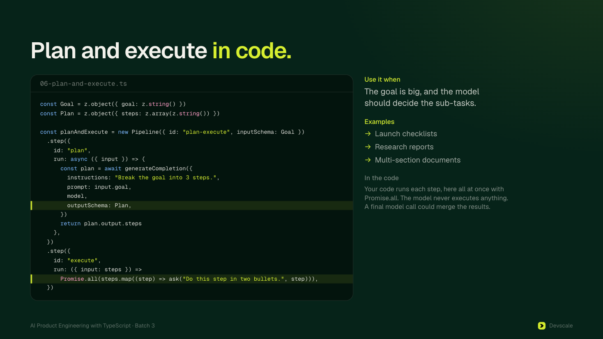

### 7. Agentic decision — `07-assistant-decision.ts`

Model memilih satu aksi dari daftar yang terbatas, lalu kode menjalankannya.

- **Kenapa:** langkah awal menuju agent. Model yang memilih, tapi aksi yang boleh dipilih dibatasi, sehingga perilakunya tetap bisa diprediksi dan aman.
- **Alur:** `decide (answer | search | handoff) → act`

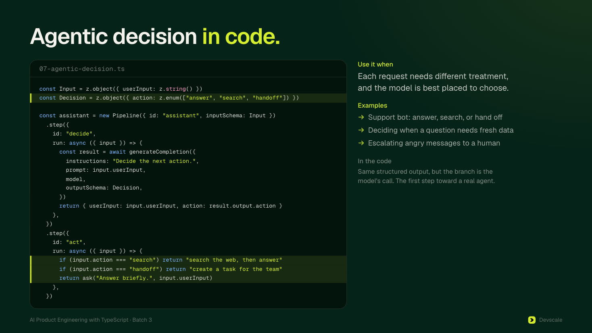

### Observability — `08-observer.ts`

Pantau tiap step saat berjalan dengan `observer.onEvent`, dan lihat bentuk pipeline dengan `graph()`.

- **Kenapa:** alur AI sering terasa seperti kotak hitam. Event menunjukkan apa yang jalan, kapan, dan di mana gagal.

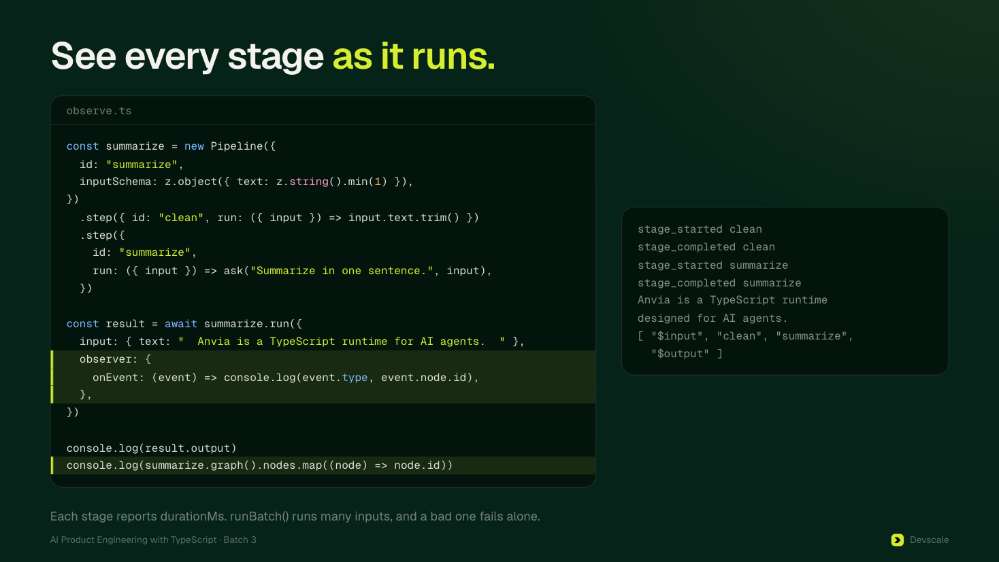

## Daftar file

| File | Isi |
|---|---|
| `index.ts` | Scratchpad dasar pipeline dari kelas |
| `01-prompt-chaining.ts` | Contoh kelas: chaining |
| `02-router.ts` | Contoh kelas: routing |
| `03-parallel-fanout.ts` | Contoh kelas: parallel |
| `00-basic-pipeline.ts` | Pipeline minimal dua langkah |
| `04-extract-company.ts` | Extraction (Tavily di-stub di dalam file) |
| `05-evaluator-optimizer.ts` | Draft, evaluasi, revisi |
| `06-plan-and-execute.ts` | Rencana, lalu eksekusi |
| `07-assistant-decision.ts` | Putuskan, lalu bertindak |
| `08-observer.ts` | Event dan graph |
| `shared.ts` | Setup model plus helper `askAi` dan `askAiJson` |
| `docs/slides/` | Screenshot slide Day 4 yang dipakai di README ini |

`01`–`03` dan `index.ts` adalah versi yang diajarkan di kelas. Di dalamnya masih ada placeholder TODO (web search, summarize, handler routing) yang diisi langsung saat kelas berlangsung.
